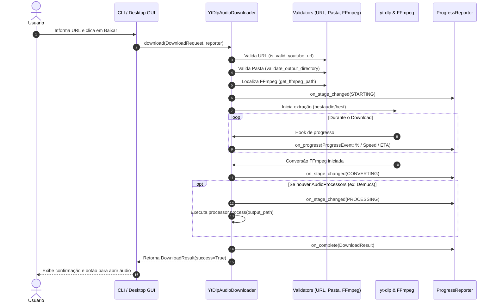

# Fluxo de Dados e Ciclo de Vida - Elo Track

Descreve a sequência de eventos desde a entrada de um link até a entrega do arquivo de áudio finalizado no disco.

---

## Diagrama de Sequência de Download

---

## Estrutura do `ProgressEvent`

Cada evento emitido pelo motor de download contém:

| Campo | Tipo | Descrição |
| :--- | :--- | :--- |
| `status` | `ProgressStatus` | Enum: `STARTING`, `DOWNLOADING`, `CONVERTING`, `PROCESSING`, `FINISHED`, `ERROR` |
| `url` | `str` | URL original da solicitação |
| `filename` | `Optional[str]` | Nome temporário ou final do arquivo |
| `downloaded_bytes` | `int` | Bytes já recebidos |
| `total_bytes` | `Optional[int]` | Tamanho total estimado em bytes |
| `percentage` | `float` | Percentual concluído (0.0 a 100.0) |
| `speed_bytes_sec` | `Optional[float]` | Velocidade instantânea em bytes/segundo |
| `eta_seconds` | `Optional[int]` | Tempo restante estimado em segundos |
